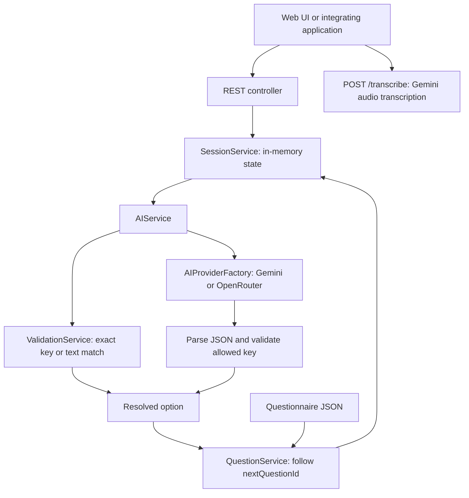

# AI Questionnaire Engine

An AI integration component built for a production legal assistance system that helps people with limited financial resources access legal guidance. This service turns natural-language replies into structured questionnaire answers, helping the surrounding system collect information for its legal assistance workflow.

This repository focuses on questionnaire intake and answer classification within that larger system. The surrounding application provides the broader legal assistance workflow; this component produces structured intake data rather than generating legal advice.

## Problem and approach

People describe their circumstances in their own words rather than database labels. The engine accepts an option key, an option's displayed text, or a free-text reply. Exact matches avoid an AI request. Other replies are classified against only the current question's allowed options. The shared prompt asks the model to interpret English, Bengali, and Banglish (Bengali written in Latin letters).

The bundled `selp.json` contains 20 Bengali questions about sexual-harassment-related legal assistance. Its content is questionnaire data, not a validated legal decision procedure.

## Architecture



- `QuestionnaireController` exposes the HTTP API and maps known failures to status codes.
- `QuestionnaireConfig` loads the resource selected by `app.questionnaire.resource`; `QuestionService` checks the start question and referenced next-question IDs at startup.
- `SessionService` stores a UUID session, current question, collected option keys, and completion flag. Answers are saved under each question's `field`.
- `AIService` first matches an option key or context, ignoring letter case and surrounding whitespace. Otherwise it sends the current question, allowed keys and contexts, collected answers, and latest reply to the selected provider. It sends no full conversation history.
- Both providers share a prompt and response parser. Markdown fences are tolerated; blank or malformed JSON becomes an unresolved classification. A result is accepted only if `valid` is true, an option key is supplied, confidence is at least `0.5`, and the key belongs to the current question. The confidence is model-reported, not a calibrated probability.
- Voice transcription always uses Gemini, independently of the classification provider. Transcription returns text; the caller submits that text through `/answer` separately.

### Conditional branching

Each option has a `key`, `context`, and `nextQuestionId`. The backend follows the selected option's next ID; a null ID completes the session. An AI model selects an allowed option and never chooses the next question directly.

The bundled questionnaire currently follows questions 1 through 20 regardless of which option is selected. The engine supports divergent paths by setting different next IDs in JSON; the bundled data does not demonstrate such divergence. Startup validation checks references, but does not detect cycles or unreachable questions.

## Run locally

Prerequisites: JDK **25**, network access for Gradle dependencies and provider calls, and a key for the chosen classification provider. The repository pins Spring Boot 4.1.0, Spring AI 2.0.0, and Gradle 9.5.1. Use the included wrapper; no separate Gradle installation is needed.

From PowerShell in this directory:

```powershell
$env:OPENROUTER_API_KEY = '<your-key>'
.\gradlew.bat bootRun
```

Open <http://localhost:8080> for the bundled UI. The default classifier is OpenRouter with `openai/gpt-4o-mini`. To use Gemini instead:

```powershell
$env:GEMINI_API_KEY = '<your-key>'
$env:APP_AI_PROVIDER = 'gemini'
.\gradlew.bat bootRun
```

On macOS/Linux, use `./gradlew bootRun` and export the equivalent environment variables. Exact option matches need no model call. Free-text classification needs the active provider's real key; audio always needs a real Gemini key. The `abc` and `xyz` fallback values in configuration are placeholders.

Configuration lives in [application.properties](src/main/resources/application.properties). Useful environment overrides:

| Variable | Purpose / repository default |
| --- | --- |
| `APP_AI_PROVIDER` | `openrouter` or `gemini`; default `openrouter` |
| `OPENROUTER_API_KEY` | OpenRouter credentials |
| `GEMINI_API_KEY` | Gemini classification and/or transcription credentials |
| `SPRING_AI_OPENAI_CHAT_MODEL` | OpenRouter model; `openai/gpt-4o-mini` |
| `SPRING_AI_GOOGLE_GENAI_CHAT_MODEL` | Gemini classifier; `gemini-2.5-flash` |
| `APP_VOICE_TRANSCRIPTION_MODEL` | Gemini audio model; `gemini-3.1-pro-preview` |
| `APP_QUESTIONNAIRE_RESOURCE` | `classpath:selp.json`; can use `file:/absolute/path/custom.json` |

Both provider clients are configured at startup; the factory selects which one classifies answers. Model names above are repository defaults, not guarantees of current provider availability. Classification temperature is configured as zero, which does not guarantee identical repeated outputs.

## API

| Method | Path | Request | Response |
| --- | --- | --- | --- |
| POST | `/session` | No body | `sessionId`, initial `question` |
| POST | `/answer` | JSON `sessionId`, `answer` | `completed`, `answers`, `nextQuestion` |
| GET | `/session/{sessionId}` | Session ID in path | Session state and `currentQuestion` |
| POST | `/transcribe` | Multipart `audio`, optional `sessionId` for question context | `transcript` |

Example using PowerShell:

```powershell
$session = Invoke-RestMethod -Method Post -Uri http://localhost:8080/session
$body = @{ sessionId = $session.sessionId; answer = '2aca3fe7-d51e-47da-a40f-9f6e1abd4d87' } | ConvertTo-Json
Invoke-RestMethod -Method Post -Uri http://localhost:8080/answer -ContentType 'application/json' -Body $body
Invoke-RestMethod -Uri "http://localhost:8080/session/$($session.sessionId)"
```

The example selects the first question's sexual-harassment option without an AI call. Use the returned question's `options` for subsequent keys. Options in API responses contain `context` and `key`. Completion returns `nextQuestion: null`. See [postman_collection.json](postman_collection.json) for additional requests.

Known controller error responses have a `message` field: blank required answer/session ID → **400**; unknown session → **404**; answer after completion → **409**; unresolved/low-confidence/disallowed classification → **422**; provider call failure → **502**. Rejected classifications and provider failures do not advance the session. Framework-level errors may have a different response shape.

`/transcribe` requires a non-empty upload whose content type starts with `audio/`. Multipart limits are 15 MB. Content-type checking alone does not validate audio bytes or model format support.
